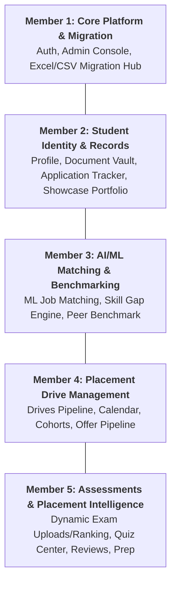

# 👥 CCIP Project Architecture: 5-Member Team Work Division & AI Debugging Blueprint

This document defines the **5 decoupled functional modules** of the **Campus Career & Curriculum Intelligence Platform (CCIP)**. Each member owns an end-to-end vertical slice (Frontend Pages, Backend API Routers, Database Models, and Testing/Debugging procedures).

> [!TIP]
> **How to use these files with AI (ChatGPT, Claude, Cursor, Copilot, etc.)**:
> Each member's file in `docs/team/` is written as a **complete, self-contained AI Engineering Prompt**.
> A team member can simply copy the entire content of their assigned file and paste it into an AI assistant. The AI will immediately understand their exact role, file inventory, API contracts, SQLite database schema, constraints, and test recipes to debug or extend their section.

---

## 🗺️ High-Level Division Overview



| Member | Module Name | Primary Responsibility | Dedicated AI Prompt File |
|---|---|---|---|
| **Member 1** | **Core Platform & Institutional Onboarding** | Auth, Security, Admin Console, Bulk Student Excel/CSV Migration Hub | [`docs/team/MEMBER_1_CORE_AND_MIGRATION.md`](docs/team/MEMBER_1_CORE_AND_MIGRATION.md) |
| **Member 2** | **Student Identity, Vault & Application Tracker** | Profile Management, Document Vault (SHA-256), Application Milestone Stepper, Public Portfolio | [`docs/team/MEMBER_2_STUDENT_IDENTITY_VAULT.md`](docs/team/MEMBER_2_STUDENT_IDENTITY_VAULT.md) |
| **Member 3** | **ML Candidate Matching & Benchmarking** | Semantic Match Engine ($R^2 \approx 0.92$), Skill Deficiency Scoring, Department Benchmark | [`docs/team/MEMBER_3_ML_MATCHING_BENCHMARK.md`](docs/team/MEMBER_3_ML_MATCHING_BENCHMARK.md) |
| **Member 4** | **Campus Drives & Placement Operations** | Placement Drives Pipeline, Interactive Drive Calendar, Candidate Cohort Builder, Offer Letters | [`docs/team/MEMBER_4_PLACEMENT_DRIVES_OPERATIONS.md`](docs/team/MEMBER_4_PLACEMENT_DRIVES_OPERATIONS.md) |
| **Member 5** | **Assessments, Dynamic Exam Sheets & Intelligence** | Dynamic Exam Sheet Ingestion & Ranking (Excel/PDF), Quiz Center, Company Reviews, Prep Hub | [`docs/team/MEMBER_5_EXAMS_ASSESSMENTS_INTELLIGENCE.md`](docs/team/MEMBER_5_EXAMS_ASSESSMENTS_INTELLIGENCE.md) |

---

## 🚀 Shared Local Development Setup (For All Members)

Every member needs to run the backend and frontend locally to test their respective modules:

### 1. Backend Server (FastAPI + SQLite)
```powershell
# From project root:
cd backend
.\.venv\Scripts\uvicorn.exe app.main:app --host 0.0.0.0 --port 8000 --reload
```
- Interactive API Documentation (Swagger): `http://localhost:8000/docs`
- Health Check: `http://localhost:8000/health`
- Database: Local SQLite file at `backend/ccip_dev.db`

### 2. Frontend Server (Vite + React + Tailwind CSS)
```powershell
# From project root:
cd frontend
npx vite --host 0.0.0.0 --port 5173
```
- Application Web URL: `http://localhost:5173`

### 3. Running Pytest Suite
```powershell
# From project root:
& "backend\.venv\Scripts\pytest.exe" backend/tests/ -v
```

---

## 🔑 Default Demo Accounts for Testing

| Role | Email | Password | Primary Routes |
|---|---|---|---|
| **Admin** | `admin@ccip.edu` | `admin123` | `/admin/dashboard`, `/admin/migration`, `/admin/users` |
| **TPO** | `tpo@ccip.edu` | `tpo123` | `/tpo/drives`, `/tpo/calendar`, `/tpo/students`, `/tpo/exam-uploads` |
| **Student** | `priya.agarwal0@ccip.edu` | `student123` | `/student/dashboard`, `/student/profile`, `/student/job-matches`, `/student/vault` |

---

## 📑 Summary of Member Modules

### 👤 Member 1: Core Platform, Authentication & Institutional Migration Hub
- **Scope**: User authentication, JWT tokens, atomic database-backed password reset replay protection, admin dashboard KPI cards, user management, and the institutional Excel/CSV migration hub for bulk student onboarding with auto-generated institutional emails and passwords.
- **Detailed AI Specification**: [`docs/team/MEMBER_1_CORE_AND_MIGRATION.md`](docs/team/MEMBER_1_CORE_AND_MIGRATION.md)

### 👤 Member 2: Student Identity, Document Vault & Application Tracker
- **Scope**: Student profile management, avatar/resume uploads, secure document vault with SHA-256 verification, visual application milestone stepper (`Applied` ➔ `Shortlisted` ➔ `Technical` ➔ `HR` ➔ `Offered`), and public showcase portfolio (`/portfolio/slug/:slug`).
- **Detailed AI Specification**: [`docs/team/MEMBER_2_STUDENT_IDENTITY_VAULT.md`](docs/team/MEMBER_2_STUDENT_IDENTITY_VAULT.md)

### 👤 Member 3: ML Job Matching, Skill Gap Engine & Peer Benchmarking
- **Scope**: Machine learning job matching using Gradient Boosting + Sentence-Transformers embeddings, skill gap breakdown with severity badges (`Critical`, `High`, etc.), dynamic "what-if" skill simulator, and peer cohort benchmark percentiles.
- **Detailed AI Specification**: [`docs/team/MEMBER_3_ML_MATCHING_BENCHMARK.md`](docs/team/MEMBER_3_ML_MATCHING_BENCHMARK.md)

### 👤 Member 4: Campus Drives, Recruiter Cohorts & Offer Pipeline
- **Scope**: TPO placement drive lifecycle (creation, eligibility criteria, stages, deadlines), student drive discovery and 1-click apply, interactive calendar grid, candidate cohort builder with multi-factor filters and CSV shortlist export, and offer letter tracking with CTC analytics.
- **Detailed AI Specification**: [`docs/team/MEMBER_4_PLACEMENT_DRIVES_OPERATIONS.md`](docs/team/MEMBER_4_PLACEMENT_DRIVES_OPERATIONS.md)

### 👤 Member 5: Assessments, Dynamic Exam Sheets & Placement Intelligence
- **Scope**: Dynamic assessment sheet upload engine (Excel/CSV/PDF) with automated percentile and rank computation, student exam score cards, timed MCQ quiz engine, peer company interview reviews with salary insights, and prep hub.
- **Detailed AI Specification**: [`docs/team/MEMBER_5_EXAMS_ASSESSMENTS_INTELLIGENCE.md`](docs/team/MEMBER_5_EXAMS_ASSESSMENTS_INTELLIGENCE.md)
